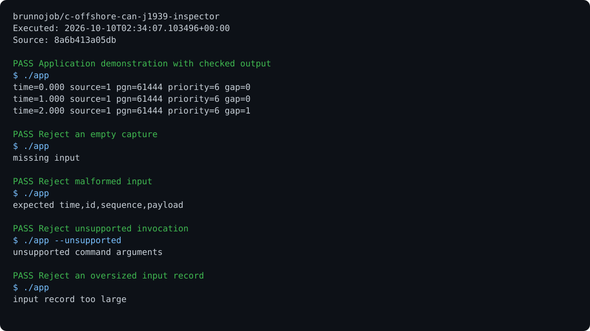

# c-offshore-can-j1939-inspector

[View execution evidence](https://brunnojob.github.io/devstart-lab/proofs/c-offshore-can-j1939-inspector/) · [Run browser demo](https://brunnojob.github.io/devstart-lab/proofs/c-offshore-can-j1939-inspector/demo/)

Decode 29-bit CAN identifiers and identify sequence gaps in recorded offshore equipment traffic.

```sh
make test
./app < examples/input.txt
```

Offline diagnostic tool. Inputs and limits must be validated for each installation; no equipment commands are sent.

MIT. Built by [brunnodev](https://brunnodev.store).

## Execution proof

[](https://github.com/brunnojob/c-offshore-can-j1939-inspector/actions/workflows/proof.yml)



[Verified run](https://github.com/brunnojob/c-offshore-can-j1939-inspector/actions/runs/38017951970) · [Execution report](docs/proof/evidence.json)

Run `python .proof/record.py` after installing the prerequisites above. The scenarios execute repository code and verify exit codes and expected output. CI publishes `execution-proof` with the transcript, input fingerprints and source commit. The downloadable report identifies the exact tested version; the workflow badge tracks the latest run.

## Co-authorship

Contribution trailer:

```text
Co-authored-by: nyctophile <33561761+ineedfoundmyway@users.noreply.github.com>
```
